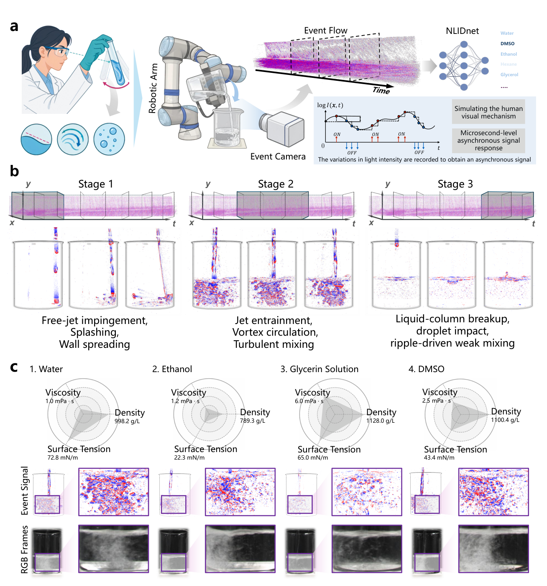
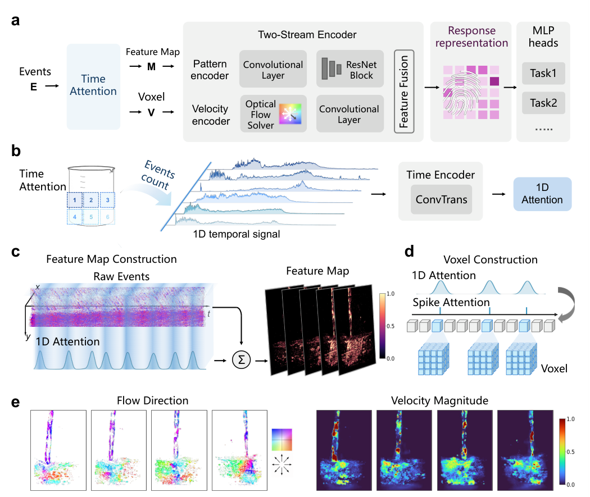
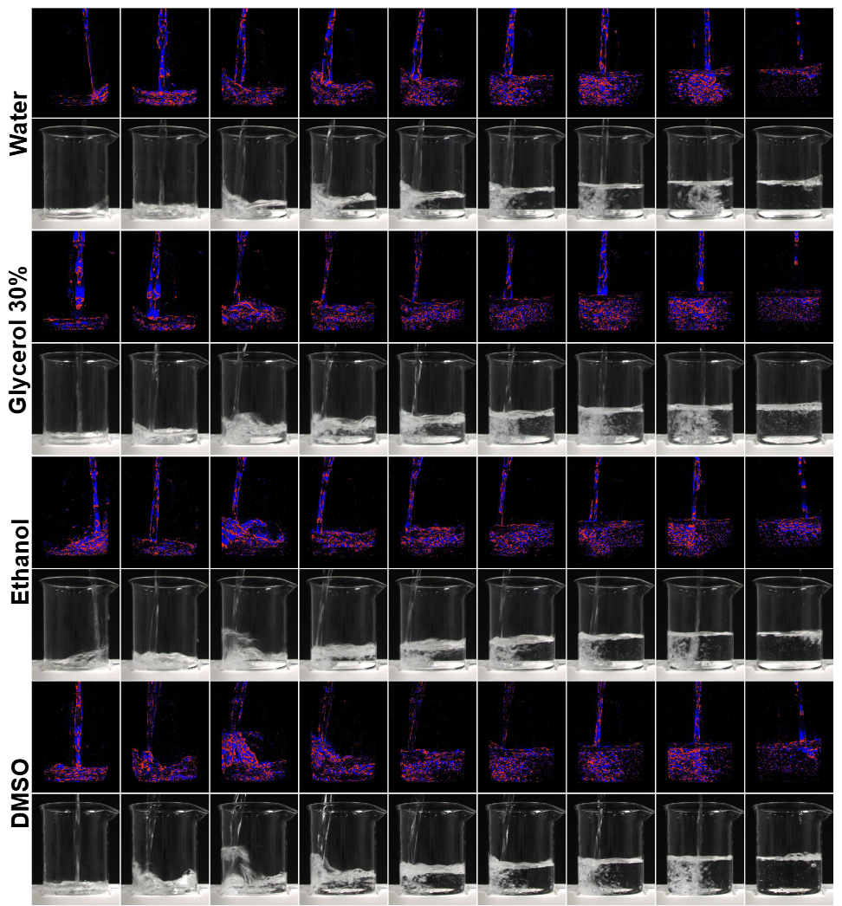
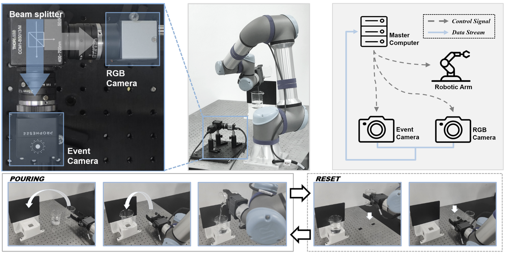

# NLIDNet

### Active Hydrodynamic Interrogation Enables Embodied Liquid Sensing

Yuliang Wu†, Wei Zhai†, Wenrui Chang†, Wendi Gan, Chenfeng Wang, Yang Cao, Zheng-Jun Zha

University of Science and Technology of China &nbsp; | &nbsp; † Equal contribution

**[Hugging Face Dataset](https://huggingface.co/datasets/GWDx/NLID)** &nbsp; | &nbsp; [Video](#video) &nbsp; | &nbsp; [Method](#method) &nbsp; | &nbsp; [Code](#code) &nbsp; | &nbsp; [Hardware](hardware/README.md) &nbsp; | &nbsp; [Citation](#citation)

A prescribed robotic pouring action elicits the transient response used for liquid sensing.Event-based vision records the non-equilibrium evolution of the jet, impact region and free surface. NLIDNet selects informative intervals and encodes the response into a protocol-conditioned representation for liquid recognition, few-shot adaptation and ethanol concentration regression.



## Video

**Event response during pouring.** Opposite event polarities are shown in red and blue. Playback follows the original sampling of the exported event snapshots.

https://github.com/user-attachments/assets/35b29a13-9c93-4753-ab63-834f00020acd

[Download MP4](assets/demos/event_pouring.mp4)

## Method

NLIDNet follows the liquid response through three complementary mechanisms:

- **Temporal selection.** A ConvTran encoder predicts temporal importance from six regional event-count signals. These weights guide event accumulation and the selection of informative flow moments.
- **Pattern and velocity encoding.** Attentive polarity maps describe the evolving interfaces; a frozen EVFlowNet and trainable velocity encoder describe their motion. The two branches form a 256-dimensional response embedding.
- **Representation learning and transfer.** Category supervision, supervised contrastive learning, attention variance regularization and auxiliary physical-attribute supervision shape the embedding. Linear probes or full fine-tuning adapt it to downstream tasks.

The experiments use a fixed pouring trajectory, vessel setup and imaging protocol. The reported setting uses the same prescribed action across liquids and trials.



The mechanisms are implemented in [time_attention.py](nlidnet/models/time_attention.py), [event_representation.py](nlidnet/models/event_representation.py), [encoders.py](nlidnet/models/encoders.py) and [losses.py](nlidnet/training/losses.py). The complete model is assembled in [network.py](nlidnet/models/network.py).

## Dataset

**[Access the NLID dataset on Hugging Face →](https://huggingface.co/datasets/GWDx/NLID)**

This work builds on our [NLID project](https://github.com/wyl-OvO/NLID), sharing its robotic pouring platform and event/RGB recordings.

Hugging Face hosts the original event-camera `.raw` recordings and RGB `.avi` videos, organized by liquid. Stage windows and model inputs are derived locally after downloading; training/test assignments are made by physical trial before temporal slicing.

The experiments study the following tasks:

| Task | Protocol |
| --- | --- |
| Liquid recognition | 16 base liquid categories |
| Few-shot recognition | Nine categories excluded from source-task training |
| Concentration estimation | Water and ten ethanol concentrations, 0-100% in 10% increments |

Three pouring stages are analysed separately. Training/test splitting is performed at the independent-trial level with an 80%/20% ratio; all stages, temporal views and crops from one trial remain in the same split.

<details>
<summary>Event and RGB observations of four liquids</summary>

Recorded pouring sequences from NLID: water, 30% glycerol, ethanol and DMSO. Event and RGB rows show the evolving liquid response at successive times.



</details>

Label mappings and manifest examples are provided in [data/](data/). The [data tools](nlidnet/data/) cover RAW decoding, six-ROI signals, trial indexing, polarity frames, time surfaces, voxel grids and validation. See the [data preparation workflow](docs/usage.md#installation-and-data-preparation) for conversion and indexing commands.

## Acquisition platform

A UR5e robot executes a prescribed pouring trajectory. A beam splitter aligns a Prophesee EVK4 event camera and an iRayple RGB camera to observe the same scene.



Camera interfaces, acquisition scripts, platform dimensions and the robot program are available in [hardware](hardware/README.md).

## Code

The model mechanisms are implemented in `nlidnet/`. Each experimental task has its own script in `experiments/`, with its data selection, training and evaluation workflow kept together.

```text
NLIDNet/
  experiments/
    train.py                    Source-task pretraining
    evaluate.py                 Trial-level evaluation
    few_shot_classification.py  Adaptation to nine novel liquid categories
    concentration_regression.py Ethanol concentration adaptation
    classification_probe.py     Classification from cached features
    concentration_probe.py      Regression from cached features
    baselines/                  Event, video, temporal and RGB experiments
    ablations/                  Velocity, temporal sampling and loss ablations
  nlidnet/
    models/          Time attention, event construction and two-stream encoders
    data/            RAW decoding, trial indexing and representations
    training/        Losses, support selection and feature probes
    analysis/        Independent correlation, statistics, embedding and timing tools
    visualization/   Attention, Grad-CAM and video rendering
  tools/             Data preparation and visualization utilities
  configs/           Paper configuration
  docs/              Installation and workflow reference
  data/              Manifest examples, labels and reference annotations
  hardware/          Camera interfaces and robot program
  assets/            Figures and video used in the documentation
```

[Installation, data preparation and experiment commands](docs/usage.md)

## Citation

```bibtex
@misc{wu_nlidnet,
  title  = {Active Hydrodynamic Interrogation Enables Embodied Liquid Sensing},
  author = {Wu, Yuliang and Zhai, Wei and Chang, Wenrui and Gan, Wendi and Wang, Chenfeng and Cao, Yang and Zha, Zheng-Jun},
  url    = {https://github.com/Changwenrui/NLIDNet},
  note   = {Manuscript}
}
```

## Acknowledgements

This work extends our [NLID project](https://github.com/wyl-OvO/NLID), sharing the pouring platform, recordings and event/RGB visualizations. We thank the authors of ConvTran, EVFlowNet, InceptionTime, VideoMAE and SpikingResformer. Source attribution is provided in [NOTICE](NOTICE).

Released under the [MIT License](LICENSE).
