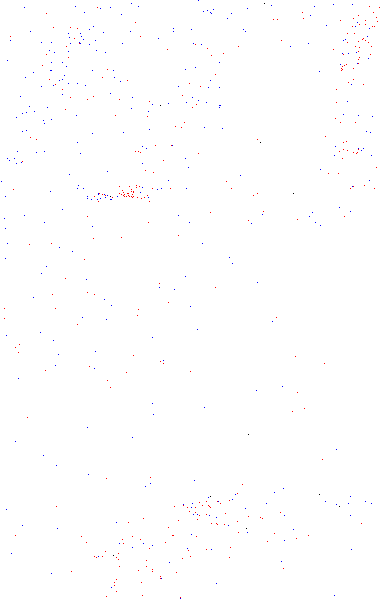
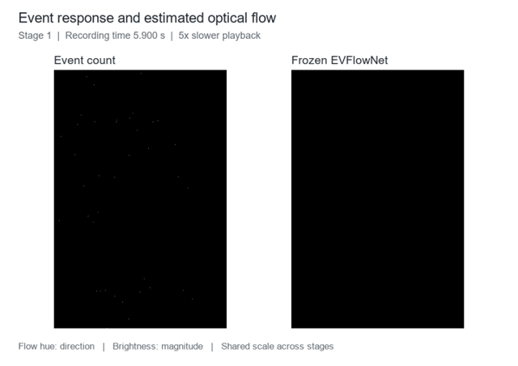

# NLIDNet

## Active Hydrodynamic Interrogation Enables Embodied Liquid Sensing

Yuliang Wu†, Wei Zhai†, Wenrui Chang†, Wendi Gan, Chenfeng Wang, Yang Cao, Zheng-Jun Zha

University of Science and Technology of China · † Equal contribution

[Dataset](https://huggingface.co/datasets/GWDx/NLID) · [Acquisition platform](hardware/README.md) · [Code](#code) · [NLID](https://github.com/wyl-OvO/NLID)

Transparent liquids can look alike at rest and respond differently when poured. We use a repeatable robotic pouring action to elicit these transient responses, record them with event-based vision, and encode their morphology and motion with NLIDNet. The learned representation supports liquid identification, few-shot adaptation and ethanol concentration regression under the acquisition protocol.


## Watching the pouring response

Event cameras record changes in brightness as the jet forms, strikes the receiving liquid and breaks up. The animation below shows event snapshots during a recorded pour; red and blue indicate opposite event polarities. [Watch the MP4](assets/demos/event_pouring.mp4).

<p align="center">
  
</p>

Paired event counts and frozen optical-flow estimates from one cached recording are shown below across the three stages. Playback is slowed by five times; the displayed timestamps refer to the original recording. [Watch the MP4](assets/demos/event_flow.mp4).



Event and RGB observations from the NLID acquisition platform:


## Automated acquisition

A UR5e robot alternates between pouring and reset actions. A beam splitter aligns the event and RGB views, allowing the two cameras to observe the same liquid response.


Camera interfaces, acquisition control, platform dimensions and the robot program are in [hardware/](hardware/README.md).

## Method


NLIDNet follows the response from regional event activity to a liquid representation:

1. **Time attention.** Six ROI count signals are encoded by ConvTran. Smoothed temporal scores produce local attention, segment weights and selected event intervals. [time_attention.py](nlidnet/models/time_attention.py)
2. **Attentive event representations.** Attention weights aggregate events into polarity feature maps; selected adjacent intervals form four-channel optical-flow inputs. [event_representation.py](nlidnet/models/event_representation.py)
3. **Pattern and velocity encoding.** A ResNet branch encodes flow morphology. A frozen EVFlowNet and a trainable velocity encoder describe motion. Their features form a 256-dimensional response embedding. [encoders.py](nlidnet/models/encoders.py)
4. **Representation learning.** Classification, supervised contrastive learning, attention variance and physical-attribute supervision train the shared encoder. [losses.py](nlidnet/training/losses.py)

The complete network is assembled in [network.py](nlidnet/models/network.py).

## Data representations


Raw recordings are retained as integer `x, y, t, p` events. Six regional count signals preserve dense temporal activity, while time surfaces, polarity frames and voxel grids provide alternative spatial representations. Preparation code is organized in [nlidnet/data/](nlidnet/data/), with a single entry point: [prepare_data.py](prepare_data.py).

The dataset is available at [GWDx/NLID](https://huggingface.co/datasets/GWDx/NLID). Liquid names, label IDs and task groups are listed in [data/liquids.csv](data/liquids.csv). Each manifest row identifies one physical pouring trial; temporal views share that trial ID.

## Code

| Purpose | Entry point | Implementation |
| --- | --- | --- |
| RAW conversion, trial indexing, representations and previews | [prepare_data.py](prepare_data.py) | [nlidnet/data](nlidnet/data/) |
| Source classification | [train.py](train.py), [evaluate.py](evaluate.py) | [nlidnet/training](nlidnet/training/) |
| Few-shot classification and concentration regression | [adapt.py](adapt.py) | [adapt.py](nlidnet/training/adapt.py), [probes.py](nlidnet/training/probes.py) |
| Event, video, temporal and appearance baselines | [baselines.py](baselines.py) | [nlidnet/models/baselines](nlidnet/models/baselines/) |
| Architecture and loss ablations | [ablations.py](ablations.py) | [ablations.py](nlidnet/models/ablations.py), [sparse_sampling.py](nlidnet/models/sparse_sampling.py) |
| Physical correlation, embeddings, event statistics and timing | [analyze.py](analyze.py) | [nlidnet/analysis](nlidnet/analysis/) |
| Attention, Grad-CAM and feature export | [visualize.py](visualize.py) | [nlidnet/visualization](nlidnet/visualization/) |
| Camera acquisition and pouring control | [hardware](hardware/README.md) | [acquisition](hardware/acquisition/), [robot](hardware/robot/) |

<details>
<summary>Installation and data preparation</summary>

Python 3.10 or later is required. Install PyTorch and torchvision for your CUDA environment, then install this repository:

```bash
pip install -e .
```

Event/video baselines and RGB controls use the optional dependencies:

```bash
pip install -e ".[baselines]"
```

Decoding Prophesee `.raw` files requires the Metavision SDK. NPY, NPZ and safetensors event arrays can be read without the camera SDK.

For existing processed data, index the paired files directly:

```bash
python prepare_data.py index-processed --event-root data/processed --output data/trials.csv
```

For raw recordings, provide the recorded split assignments (`raw_path,split`, with optional `trial_id,prefix`) and convert them:

```bash
python prepare_data.py index-raw --raw-root data/raw --split-file data/splits.csv --output data/trials.csv
python prepare_data.py prepare --raw-root data/raw --manifest data/trials.csv --output data/processed
```

If preparing a new dataset, `index-raw --test-per-class 10` creates a new split from naturally sorted filenames. It does not recover the manuscript's original split. `--folder-map` accepts a JSON mapping from canonical liquid names to source folder names.

Each trial produces:

```text
data/processed/train/<prefix>.pt             Six ROI signals, [6,9000]
data/processed/train/<prefix>.safetensors    Integer x,y,t,p events
data/processed/train/<prefix>.txt            Raw liquid label
```

Test trials use `test/`. The trial schema is shown in [data/trials.example.csv](data/trials.example.csv). Existing processed indices preserve filenames; their generated trial IDs are `split_prefix`. Use the recorded physical trial IDs in an existing manifest when available.

```bash
python prepare_data.py validate
python prepare_data.py preview --events data/processed/test/00000001.safetensors
python prepare_data.py represent --manifest data/trials.csv --event-root data/processed --representation time_surface
```

`represent` also supports `event_frame` and `voxel_grid`, event-count or temporal partitioning, custom ROIs, partial event segments and shifted views. `prepare --labels 25 26 27 28 29` processes added ethanol concentrations without changing the label map.

</details>

<details>
<summary>Training, adaptation and comparison experiments</summary>

Run commands from the repository root. [configs/paper.yaml](configs/paper.yaml) contains the manuscript settings: 150 source-training epochs, supervised contrastive weight 0.02, physical supervision weight 0.10 and attention variance weight 0.0005. Stage windows start at bins 2950, 3650 and 4350 and contain 700 bins of 2 ms each.

Place `resnet34_imagenet1k_v1.pth` and `evflownet.pth` in `checkpoints/`, or set their paths in the configuration. Evaluation checkpoints include the optical-flow network.

```bash
python train.py --stage stage1
python evaluate.py --stage stage1 --checkpoint outputs/stage1/pretrain/final.pth
python adapt.py classification --stage stage1 --checkpoint outputs/stage1/pretrain/final.pth --method linear_probe --shots 1 5 10 20 --seeds 1 2 3
python adapt.py concentration --stage stage1 --checkpoint outputs/stage1/pretrain/final.pth --method full_ft --shots 5 10 --seeds 1
```

Adaptation supports `linear_probe`, `full_ft` and `no_task_pretrain`. Support sets are selected by trial and nested across shot counts for each seed. `--support-order` accepts the recorded support-order CSV. Classification probes use 500 epochs; regression probes and full fine-tuning use 100 epochs.

Cached features can be used to compare linear and MLP heads:

```bash
python adapt.py classification --cached --train-features train_views.npz --test-features test_views.npz --heads linear mlp --shots 1 5 10 20 --seeds 1 2 3
```

Event baselines include AlexNet-LSTM, MobileNetV3-Chem and SpikingResformer; video baselines include VideoMAE, Go With the Flow and Don't Look Twice. Their manifests use `representation_path` or `video_path`, respectively; see [data/baselines.example.csv](data/baselines.example.csv).

```bash
python baselines.py train --model alexnet_lstm --stage stage1 --manifest data/representations/stage1/trials.csv --data-root data/representations/stage1
python baselines.py evaluate --model alexnet_lstm --stage stage1 --manifest data/representations/stage1/trials.csv --data-root data/representations/stage1 --checkpoint outputs/baselines/alexnet_lstm/stage1/final.pth
python ablations.py architecture --ablation no_flow --stage stage1
python ablations.py architecture --ablation uniform --sample-count 50 --stage stage1
python ablations.py architecture --ablation sparse --sample-count 50 --sparse-bin-us 200 --stage stage1 --accumulation-steps 4
python ablations.py loss-weights --physics 0.1 0.3 --contrastive 0.02 --variance 0.0005 --stage stage1
```

Spatial-compression baselines from NLID include ConvTran, Transformer and InceptionTime. RGB appearance controls select the first frame, last frame or a frame during pouring, with optional grayscale conversion or a frozen backbone:

```bash
python baselines.py control --kind temporal --model inception_time --stage stage1
python baselines.py control --kind temporal --model convtran --task regression --stage stage2
python baselines.py control --kind rgb --manifest data/rgb_trials.csv --video-root data/rgb --frame-mode first_frame --initialization checkpoints/resnet34_imagenet1k_v1.pth --freeze-backbone
```

</details>

<details>
<summary>Visualization and representation analysis</summary>

```bash
python visualize.py attention --stage stage1 --checkpoint outputs/stage1/pretrain/final.pth --trial-id water_trial_002 --output outputs/attention
python visualize.py gradcam --stage stage1 --checkpoint outputs/stage1/pretrain/final.pth --trial-ids water_trial_002 --output outputs/gradcam
python visualize.py features --stage stage1 --checkpoint outputs/stage1/pretrain/final.pth --split train --output outputs/train_features
python visualize.py export-attention --stage stage1 --checkpoint outputs/stage1/pretrain/final.pth --output outputs/temporal_attention
```

Feature export saves per-view embeddings in `views.npz` and trial-averaged embeddings in `embeddings.npz`. Grad-CAM export retains activations, gradients, raw maps and event backgrounds. `visualize.py render-gradcam` renders these caches without rerunning the model. Temporal exports include encoder logits, smoothed logits, local attention, segment weights and selected bins.

```bash
python analyze.py physics --event-features event_features.pt --rgb-features rgb_features.pt
python analyze.py embeddings --features outputs/test_features/embeddings.npz --reference-features outputs/train_features/embeddings.npz
python analyze.py statistics --stage stage1 --shots 5
python analyze.py speed --stage stage1 --checkpoint outputs/stage1/pretrain/final.pth
python analyze.py flow --events data/processed/test/00000001.safetensors --stage stage1
python analyze.py plot-embeddings --features outputs/test_features/embeddings.npz --method tsne
```

Videos can also be assembled from existing frame sequences or paired event/flow caches:

```bash
python visualize.py video --frames path/to/event_frames --output outputs/event_pouring.mp4 --fps 50
python analyze.py flow --events data/processed/test/00000001.safetensors --dense --all-stages --context-px 64 --output outputs/flow_cache
python visualize.py flow-video --cache-root outputs/flow_cache --output outputs/event_flow.mp4 --gif outputs/event_flow.gif --slowdown 5
```

MP4 export uses H.264 with browser-compatible pixel format. Install FFmpeg or `pip install -e ".[media]"`. Event-frame timing uses the frame index and bin width; flow-cache timing comes from each stage's `meta.json`.

`physics` performs PCA-CCA with permutation and bootstrap analysis. `statistics` tests low-order event descriptors. `embeddings` reports class separation and reference-class distances. Each command lists its options through `--help`.

</details>

## Citation

```bibtex
@misc{wu_nlidnet,
  title  = {Active Hydrodynamic Interrogation Enables Embodied Liquid Sensing},
  author = {Wu, Yuliang and Zhai, Wei and Chang, Wenrui and Gan, Wendi and Wang, Chenfeng and Cao, Yang and Zha, Zheng-Jun},
  url    = {https://github.com/Changwenrui/NLIDNet},
  note   = {Manuscript}
}
```

## Acknowledgements

This work extends our [NLID project](https://github.com/wyl-OvO/NLID), sharing the pouring platform, recordings and event/RGB visualizations. We thank the authors of ConvTran, EVFlowNet, InceptionTime, VideoMAE and SpikingResformer. Source attribution is provided in [NOTICE](NOTICE).

Released under the [MIT License](LICENSE).
