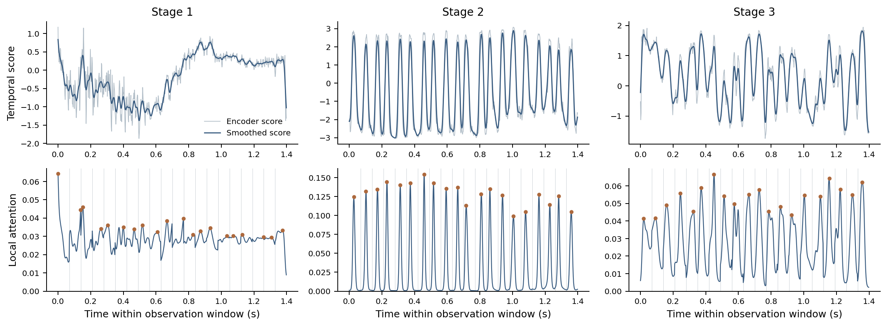
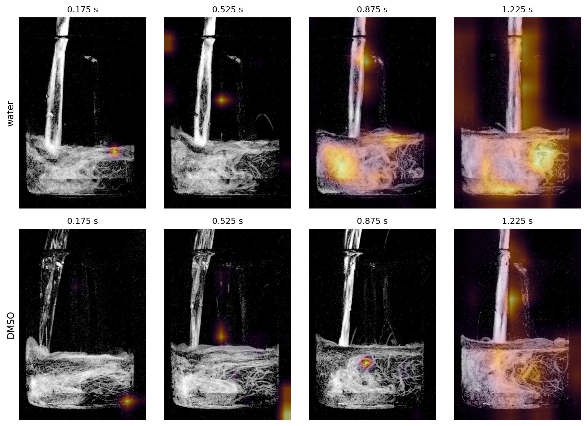
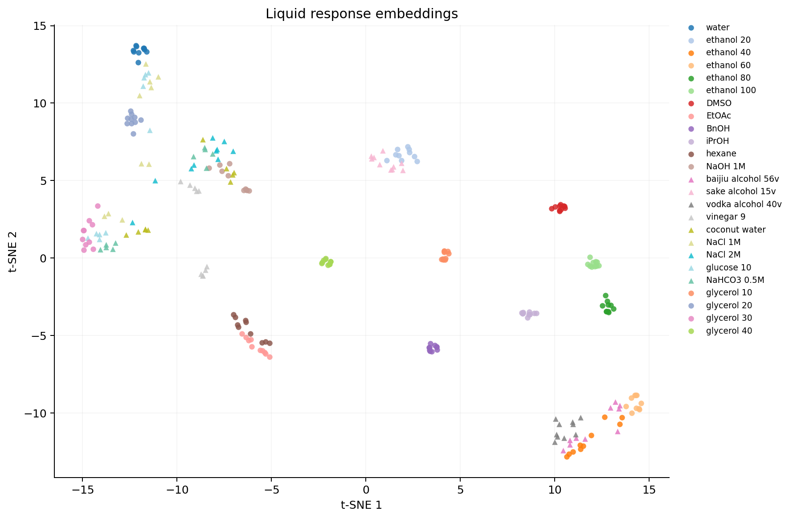
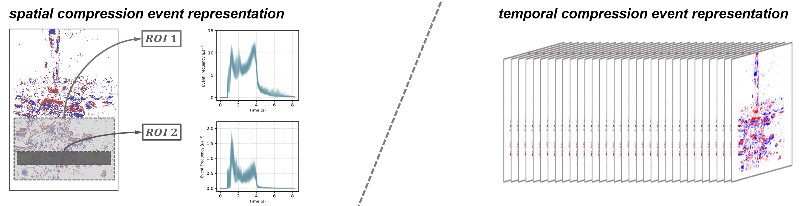

# NLIDNet

## Active Hydrodynamic Interrogation Enables Embodied Liquid Sensing

Yuliang Wu†, Wei Zhai†, Wenrui Chang†, Wendi Gan, Chenfeng Wang, Yang Cao, Zheng-Jun Zha

University of Science and Technology of China | † Equal contribution

[Videos](#videos) | [Method](#method) | [Visualizations](#reading-the-learned-response) | [Dataset](https://huggingface.co/datasets/GWDx/NLID) | [Hardware](hardware/README.md) | [Code](#code)

Transparent liquids may look nearly identical at rest, yet respond differently when accelerated, deformed and poured. We study whether a robot can create an informative sensing signal through its own manipulation action. A repeatable pouring trajectory elicits a transient hydrodynamic response; event-based vision records its evolution; NLIDNet encodes the response into a compact liquid representation.

The observation is the liquid's response to a prescribed action: jet formation, impact, entrainment, breakup and surface relaxation. Temporal selection and two complementary visual branches allow the encoder to follow both the morphology and motion of these evolving interfaces. The resulting representation is used for liquid classification, adaptation to previously unseen categories and ethanol concentration regression.


- **Action as measurement.** A standardized robotic pour supplies the stimulus that reveals otherwise weak appearance differences.
- **Event-based response readout.** Asynchronous brightness changes capture rapidly evolving jets, droplets and liquid interfaces.
- **Selective temporal encoding.** Six regional signals guide event aggregation and the choice of motion-estimation intervals.
- **A shared response representation.** Pattern and velocity descriptors form a 256-dimensional embedding for multiple downstream tasks.

## Videos

### Event response during pouring

A recorded pouring sequence viewed through the event camera. Red and blue indicate opposite event polarities. The video includes the recording timestamp and uses the original temporal sampling of the exported snapshots.

https://github.com/user-attachments/assets/c12133d8-801f-491e-a1a2-0421f549f4e0

### Event counts and estimated optical flow

Paired event counts and frozen EVFlowNet estimates from the same recording, covering all three stages. Playback is five times slower than the recorded process. Flow hue indicates direction and brightness indicates magnitude, with one display scale shared across stages.

https://github.com/user-attachments/assets/3ac0531d-4cbe-4bfb-9ef6-c6cb29ca0284

MP4 copies are retained in [assets/demos](assets/demos/).

## The pouring response

Pouring produces several regimes within one trial. The initial liquid jet forms and strikes the receiving vessel; continued pouring develops entrainment and circulation; the later response includes column breakup, droplets and weak surface motion. These stages provide different views of the same elicited liquid response.

| Observation window | Recording time | Representative dynamics |
| --- | --- | --- |
| Stage 1 | 5.90-7.30 s | Jet formation, impact, splashing and wall spreading |
| Stage 2 | 7.30-8.70 s | Developed impingement, entrainment and mixing |
| Stage 3 | 8.70-10.10 s | Column breakup, droplet impact and surface relaxation |

Each nominal window contains 700 bins at 2 ms resolution. Temporal views within a trial shift the observation window while retaining the same physical trial identifier.

Event and RGB observations from our NLID acquisition platform illustrate the different appearances of the evolving flow:


## Method

NLIDNet maps the event stream to a response embedding through temporal attention, attentive event representations and a two-stream encoder.


### Regional signals and temporal selection

The observation region is divided into six fixed ROIs. Counting events in each ROI produces a `6 x 700` signal for a stage window. A ConvTran-based time encoder predicts a score for every fine temporal bin. Gaussian smoothing connects nearby scores before attention is computed.

The window is divided into 20 segments, each containing 35 fine bins. Attention is normalized within each segment:

$$
\alpha_{m,j}=\operatorname{softmax}_{j}(s_{m,j}),
\qquad
j_m^{*}=\arg\max_j\alpha_{m,j}.
$$

Local weights guide event-map construction. Selected bins identify adjacent intervals for optical-flow estimation. A second set of weights, obtained from segment scores, controls velocity-feature aggregation. The implementation is in [time_attention.py](nlidnet/models/time_attention.py).

### Attentive pattern and velocity encoding

The **pattern branch** accumulates positive and negative events using the learned local weights, yielding 20 polarity feature maps. A convolutional downsampler and ResNet34 encode their spatial structure. Segment features are averaged to summarize flow morphology.

The **velocity branch** constructs four-channel inputs containing polarity counts and normalized event timestamps. Two adjacent inputs are selected for each segment. A frozen EVFlowNet estimates motion, a trainable convolutional encoder extracts velocity descriptors, and segment attention combines them over time.

Pattern and velocity descriptors are concatenated and projected into a 256-dimensional response embedding. Classification and physical-attribute heads operate on this shared representation. See [event_representation.py](nlidnet/models/event_representation.py), [encoders.py](nlidnet/models/encoders.py) and the assembled [network.py](nlidnet/models/network.py).

### Representation learning and adaptation

Source training combines category supervision, supervised contrastive learning, attention variance regularization and auxiliary physical-attribute supervision:

$$
\mathcal{L}=\mathcal{L}_{\mathrm{cls}}
+\lambda_{\mathrm{con}}\mathcal{L}_{\mathrm{con}}
+\lambda_{\mathrm{var}}\mathcal{L}_{\mathrm{var}}
+\lambda_{\mathrm{phys}}\mathcal{L}_{\mathrm{phys}}.
$$

The auxiliary targets are standardized reference values of density, viscosity and surface tension for the base categories. Downstream heads adapt the embedding to novel-category recognition or concentration regression. The encoder can remain frozen for a linear probe or be updated through full fine-tuning. The training objective is implemented in [losses.py](nlidnet/training/losses.py).

## Reading the learned response

### When does the encoder attend?

The following example shows one water recording across the three stages. The upper panels contain encoder scores and their smoothed versions. The lower panels show local attention, with markers at the selected bins. Attention is normalized separately within each 70 ms segment.



### Where does the pattern branch respond?

Grad-CAM overlays from the main model show spatial responses for water and DMSO during Stage 2. Each column corresponds to the same relative time in the observation window. The maps are computed from cached layer activations and gradients and normalized per frame for display.



These maps locate class-related image responses; they are not direct measurements of an individual physical property.

### How are liquid representations organized?

A t-SNE projection of Stage 1 test embeddings illustrates the organization of the learned representation across the 16 base and nine novel liquid categories. Circles denote base categories and triangles denote categories excluded from source-task training. The projection is generated from exported feature vectors with a fixed seed.



Temporal plots, spatial overlays and feature projections can be generated through `nlidnet visualize`. The plotting implementations are in [nlidnet/visualization](nlidnet/visualization/).

## Tasks and data

The experiments use independent pouring trials from [NLID](https://huggingface.co/datasets/GWDx/NLID). The acquisition platform and dataset originate from our [NLID project](https://github.com/wyl-OvO/NLID), and this work develops the action-conditioned response encoder and its transfer tasks.

| Task | Samples and labels | Model use |
| --- | --- | --- |
| Source liquid classification | 16 base liquid categories | Learn the shared response representation |
| Few-shot liquid classification | Nine categories excluded from source-task training | Adapt with a small labelled support set |
| Ethanol concentration regression | Water and ten ethanol concentrations, from 0% to 100% in 10% increments | Predict concentration from the response embedding |

Water and the ethanol conditions overlap between source classification and the concentration task. Full label mappings are provided in [data/liquids.csv](data/liquids.csv).

### From RAW recordings to model inputs

A physical trial is indexed once in a manifest, which records its identifier, label, split and file prefix. Processing retains integer `x, y, t, p` event arrays and derives six regional count signals. Stage cropping happens when samples are loaded, so all temporal views remain attached to the original trial.



Alternative representations include time surfaces, polarity frames and voxel grids. The data tools support both RAW conversion and indexing an existing processed dataset. [nlidnet/data](nlidnet/data/) contains readers, indexing, representation construction, sampling and validation.

### Evaluation protocol

Classification predictions are aggregated across temporal views at the independent trial level. Few-shot support is also counted by physical trial, including when feature files contain several views of the same recording. Support sets are nested across shot settings and can be supplied through a recorded support order.

The repository includes source training, cached linear/MLP probes, full fine-tuning, training without task-specific pretraining, event/video baselines, temporal baselines, RGB appearance controls and architecture/loss ablations. Analysis tools cover feature geometry, physical-property correlation, low-order event statistics and inference timing.

## Acquisition platform

A UR5e robot executes the prescribed pouring and reset sequence. A beam splitter aligns the event and RGB camera views so that both sensors observe the same scene.


| Component | Configuration |
| --- | --- |
| Event camera | Prophesee EVK4, 1280 x 720 pixels |
| RGB camera | iRayple A3139MU000, 35 fps |
| Optical alignment | Thorlabs CCM1-BS013M beam splitter |
| Manipulation | Universal Robots UR5e and DH-Robotics gripper |

Camera interfaces, acquisition control, platform dimensions and the robot program are provided in [hardware](hardware/README.md).

The representation is conditioned on the pouring action, vessels and imaging protocol. Its application to other acquisition settings requires evaluation under those settings.

## Code

The repository has one command interface, `nlidnet`. All command implementations live together in [nlidnet/commands](nlidnet/commands/); the remaining package directories contain the underlying implementations.

```text
NLIDNet/
  nlidnet/
    commands/        Command-line workflows
    models/          Time attention, event construction and two-stream encoders
    data/            RAW decoding, trial indexing and representations
    training/        Objectives, source training and adaptation
    analysis/        Correlation, statistics, embeddings and timing
    visualization/   Attention, Grad-CAM, galleries and video export
  configs/           Paper configuration
  data/              Manifest examples, labels and reference annotations
  hardware/          Camera interfaces and robot program
  assets/            Article figures and demonstration videos
  tests/             Functional checks
```

| Workflow | Command | Implementation |
| --- | --- | --- |
| RAW processing and indexing | `nlidnet data` | [data commands](nlidnet/commands/prepare_data.py) |
| Source training | `nlidnet train` | [training](nlidnet/training/train.py) |
| Trial-level evaluation | `nlidnet evaluate` | [evaluation](nlidnet/training/evaluate.py) |
| Few-shot classification and concentration regression | `nlidnet adapt` | [adaptation](nlidnet/training/adapt.py), [cached probes](nlidnet/training/probes.py) |
| Event, video, temporal and RGB controls | `nlidnet baselines` | [baseline models](nlidnet/models/baselines/) |
| Architecture and loss ablations | `nlidnet ablations` | [ablation models](nlidnet/models/ablations.py) |
| Representation analysis | `nlidnet analyze` | [analysis](nlidnet/analysis/) |
| Figures and video export | `nlidnet visualize` | [visualization](nlidnet/visualization/) |

`python -m nlidnet` provides the same interface. Run `nlidnet --help` or add `--help` after a command to inspect its options.

<details>
<summary>Installation and data preparation</summary>

Python 3.10 or later is required. Install PyTorch and torchvision for your CUDA environment, then install this repository:

```bash
pip install -e .
```

Event/video baselines and RGB controls use the optional dependencies:

```bash
pip install -e ".[baselines]"
```

Decoding Prophesee `.raw` files requires the Metavision SDK. NPY, NPZ and safetensors event arrays can be read without the camera SDK.

For existing processed data, index the paired files directly:

```bash
python -m nlidnet data index-processed --event-root data/processed --output data/trials.csv
```

For raw recordings, provide the recorded split assignments (`raw_path,split`, with optional `trial_id,prefix`) and convert them:

```bash
python -m nlidnet data index-raw --raw-root data/raw --split-file data/splits.csv --output data/trials.csv
python -m nlidnet data prepare --raw-root data/raw --manifest data/trials.csv --output data/processed
```

If preparing a new dataset, `index-raw --test-per-class 10` creates a new split from naturally sorted filenames. It does not recover the manuscript's original split. `--folder-map` accepts a JSON mapping from canonical liquid names to source folder names.

Each trial produces:

```text
data/processed/train/<prefix>.pt             Six ROI signals, [6,9000]
data/processed/train/<prefix>.safetensors    Integer x,y,t,p events
data/processed/train/<prefix>.txt            Raw liquid label
```

Test trials use `test/`. The trial schema is shown in [data/trials.example.csv](data/trials.example.csv). Existing processed indices preserve filenames; their generated trial IDs are `split_prefix`. Use the recorded physical trial IDs in an existing manifest when available.

```bash
python -m nlidnet data validate
python -m nlidnet data preview --events data/processed/test/00000001.safetensors
python -m nlidnet data represent --manifest data/trials.csv --event-root data/processed --representation time_surface
```

`represent` also supports `event_frame` and `voxel_grid`, event-count or temporal partitioning, custom ROIs, partial event segments and shifted views. `prepare --labels 25 26 27 28 29` processes added ethanol concentrations without changing the label map.

</details>

<details>
<summary>Training, adaptation and comparison experiments</summary>

Run commands from the repository root. [configs/paper.yaml](configs/paper.yaml) contains the manuscript settings: 150 source-training epochs, supervised contrastive weight 0.02, physical supervision weight 0.10 and attention variance weight 0.0005. Stage windows start at bins 2950, 3650 and 4350 and contain 700 bins of 2 ms each.

Place `resnet34_imagenet1k_v1.pth` and `evflownet.pth` in `checkpoints/`, or set their paths in the configuration. Evaluation checkpoints include the optical-flow network.

```bash
python -m nlidnet train --stage stage1
python -m nlidnet evaluate --stage stage1 --checkpoint outputs/stage1/pretrain/final.pth
python -m nlidnet adapt classification --stage stage1 --checkpoint outputs/stage1/pretrain/final.pth --method linear_probe --shots 1 5 10 20 --seeds 1 2 3
python -m nlidnet adapt concentration --stage stage1 --checkpoint outputs/stage1/pretrain/final.pth --method full_ft --shots 5 10 --seeds 1
```

Adaptation supports `linear_probe`, `full_ft` and `no_task_pretrain`. Support sets are selected by trial and nested across shot counts for each seed. `--support-order` accepts the recorded support-order CSV. Classification probes use 500 epochs; regression probes and full fine-tuning use 100 epochs.

Cached features can be used to compare linear and MLP heads:

```bash
python -m nlidnet adapt classification --cached --train-features train_views.npz --test-features test_views.npz --heads linear mlp --shots 1 5 10 20 --seeds 1 2 3
```

Event baselines include AlexNet-LSTM, MobileNetV3-Chem and SpikingResformer; video baselines include VideoMAE, Go With the Flow and Don't Look Twice. Their manifests use `representation_path` or `video_path`, respectively; see [data/baselines.example.csv](data/baselines.example.csv).

```bash
python -m nlidnet baselines train --model alexnet_lstm --stage stage1 --manifest data/representations/stage1/trials.csv --data-root data/representations/stage1
python -m nlidnet baselines evaluate --model alexnet_lstm --stage stage1 --manifest data/representations/stage1/trials.csv --data-root data/representations/stage1 --checkpoint outputs/baselines/alexnet_lstm/stage1/final.pth
python -m nlidnet ablations architecture --ablation no_flow --stage stage1
python -m nlidnet ablations architecture --ablation uniform --sample-count 50 --stage stage1
python -m nlidnet ablations architecture --ablation sparse --sample-count 50 --sparse-bin-us 200 --stage stage1 --accumulation-steps 4
python -m nlidnet ablations loss-weights --physics 0.1 0.3 --contrastive 0.02 --variance 0.0005 --stage stage1
```

Spatial-compression baselines from NLID include ConvTran, Transformer and InceptionTime. RGB appearance controls select the first frame, last frame or a frame during pouring, with optional grayscale conversion or a frozen backbone:

```bash
python -m nlidnet baselines control --kind temporal --model inception_time --stage stage1
python -m nlidnet baselines control --kind temporal --model convtran --task regression --stage stage2
python -m nlidnet baselines control --kind rgb --manifest data/rgb_trials.csv --video-root data/rgb --frame-mode first_frame --initialization checkpoints/resnet34_imagenet1k_v1.pth --freeze-backbone
```

</details>

<details>
<summary>Visualization and representation analysis</summary>

```bash
python -m nlidnet visualize attention --stage stage1 --checkpoint outputs/stage1/pretrain/final.pth --trial-id water_trial_002 --output outputs/attention
python -m nlidnet visualize gradcam --stage stage1 --checkpoint outputs/stage1/pretrain/final.pth --trial-ids water_trial_002 --output outputs/gradcam
python -m nlidnet visualize features --stage stage1 --checkpoint outputs/stage1/pretrain/final.pth --split train --output outputs/train_features
python -m nlidnet visualize export-attention --stage stage1 --checkpoint outputs/stage1/pretrain/final.pth --output outputs/temporal_attention
```

Feature export saves per-view embeddings in `views.npz` and trial-averaged embeddings in `embeddings.npz`. Grad-CAM export retains activations, gradients, raw maps and event backgrounds. `nlidnet visualize render-gradcam` renders these caches without rerunning the model. Temporal exports include encoder logits, smoothed logits, local attention, segment weights and selected bins. Composite figures can be rendered from the same caches:

```bash
python -m nlidnet visualize gallery --kind temporal --caches path/to/stage1/attention.npz path/to/stage2/attention.npz path/to/stage3/attention.npz --output outputs/temporal_gallery.png
python -m nlidnet visualize gallery --kind gradcam --caches path/to/water/gradcam.npz path/to/DMSO/gradcam.npz --output outputs/spatial_gallery.png
python -m nlidnet visualize gallery --kind embeddings --caches outputs/test_features/embeddings.npz --output outputs/liquid_embeddings.png
```

```bash
python -m nlidnet analyze physics --event-features event_features.pt --rgb-features rgb_features.pt
python -m nlidnet analyze embeddings --features outputs/test_features/embeddings.npz --reference-features outputs/train_features/embeddings.npz
python -m nlidnet analyze statistics --stage stage1 --shots 5
python -m nlidnet analyze speed --stage stage1 --checkpoint outputs/stage1/pretrain/final.pth
python -m nlidnet analyze flow --events data/processed/test/00000001.safetensors --stage stage1
python -m nlidnet analyze plot-embeddings --features outputs/test_features/embeddings.npz --method tsne
```

Videos can also be assembled from existing frame sequences or paired event/flow caches:

```bash
python -m nlidnet visualize video --frames path/to/event_frames --output outputs/event_pouring.mp4 --fps 50
python -m nlidnet analyze flow --events data/processed/test/00000001.safetensors --dense --all-stages --context-px 64 --output outputs/flow_cache
python -m nlidnet visualize flow-video --cache-root outputs/flow_cache --output outputs/event_flow.mp4 --gif outputs/event_flow.gif --slowdown 5
```

MP4 export uses H.264 with browser-compatible pixel format. Install FFmpeg or `pip install -e ".[media]"`. Event-frame timing uses the frame index and bin width; flow-cache timing comes from each stage's `meta.json`.

`physics` performs PCA-CCA with permutation and bootstrap analysis. `statistics` tests low-order event descriptors. `embeddings` reports class separation and reference-class distances. Each command lists its options through `--help`.

</details>

## Citation

```bibtex
@misc{wu_nlidnet,
  title  = {Active Hydrodynamic Interrogation Enables Embodied Liquid Sensing},
  author = {Wu, Yuliang and Zhai, Wei and Chang, Wenrui and Gan, Wendi and Wang, Chenfeng and Cao, Yang and Zha, Zheng-Jun},
  url    = {https://github.com/Changwenrui/NLIDNet},
  note   = {Manuscript}
}
```

## Acknowledgements

This work extends our [NLID project](https://github.com/wyl-OvO/NLID), sharing the pouring platform, recordings and event/RGB visualizations. We thank the authors of ConvTran, EVFlowNet, InceptionTime, VideoMAE and SpikingResformer. Source attribution is provided in [NOTICE](NOTICE).

Released under the [MIT License](LICENSE).
