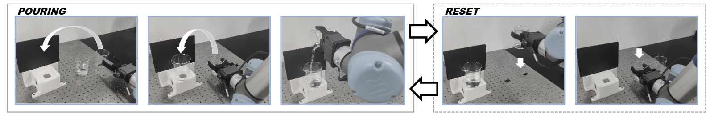
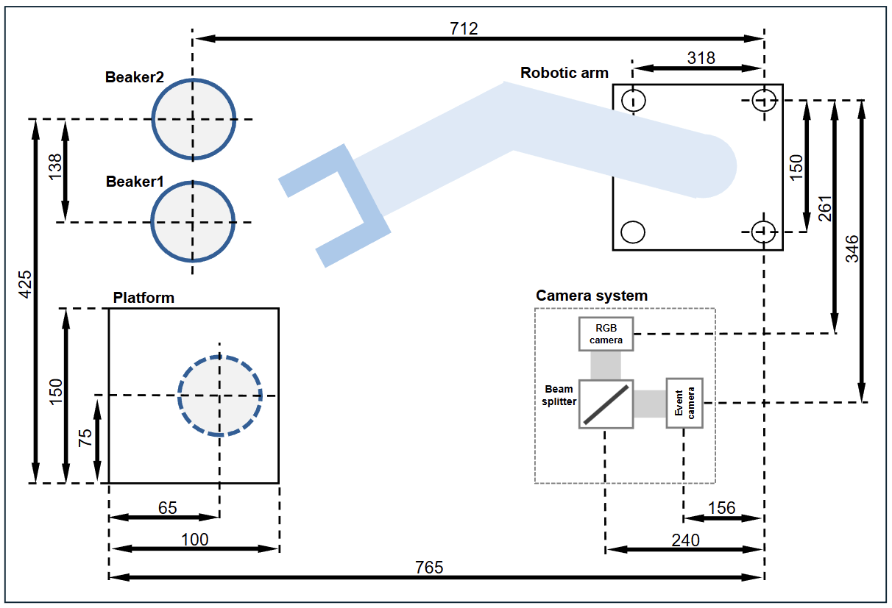

# Data acquisition

| Component | Model |
| --- | --- |
| Event camera | Prophesee EVK4, 1280 x 720 |
| RGB camera | iRayple A3139MU000, 1280 x 1024 |
| Beam splitter | Thorlabs CCM1-BS013M |
| Robot | Universal Robots UR5e |
| Gripper | DH-Robotics PGI-140-80-W-S |





## Setup

Install the Metavision SDK and iRayple MVviewer Python SDK on the acquisition host. Set `IRAYPLE_SDK_PATH` to the MVviewer SDK directory; the default is `/opt/HuarayTech/MVviewer/share/Python/MVSDK`.

Load [robot/pouring.script](robot/pouring.script) on the robot controller. Set the calibrated poses, payload, gripper parameters and callback host for the platform. Edit [config.yaml](config.yaml) for the robot IP, listener port, camera ROIs, event biases and RGB exposure. Set the RGB camera to 35 fps through the camera SDK.

## Recording

Run from the repository root:

```bash
python -m hardware.acquisition.record_trial capture/event1.raw capture/rgb1 --config hardware/config.yaml
python -m hardware.acquisition.record_series capture 1 3 --config hardware/config.yaml
```

The host and robot exchange `start program`, `start rotate`, `end rotate` and `end program` messages to coordinate event and RGB acquisition.

`acquisition/rgb_camera.py` provides the RGB camera interface. `record_trial.py` records one trial, and `record_series.py` records a sequence. The acquisition software is also available in [NLID/data-recording](https://github.com/wyl-OvO/NLID/tree/main/data-recording).
